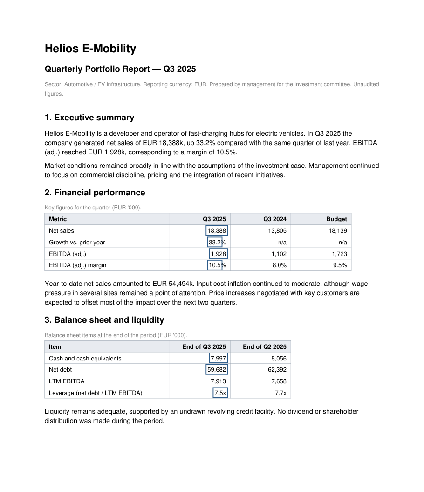
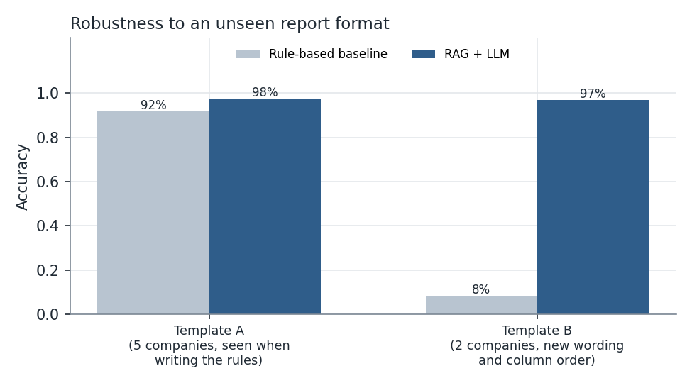
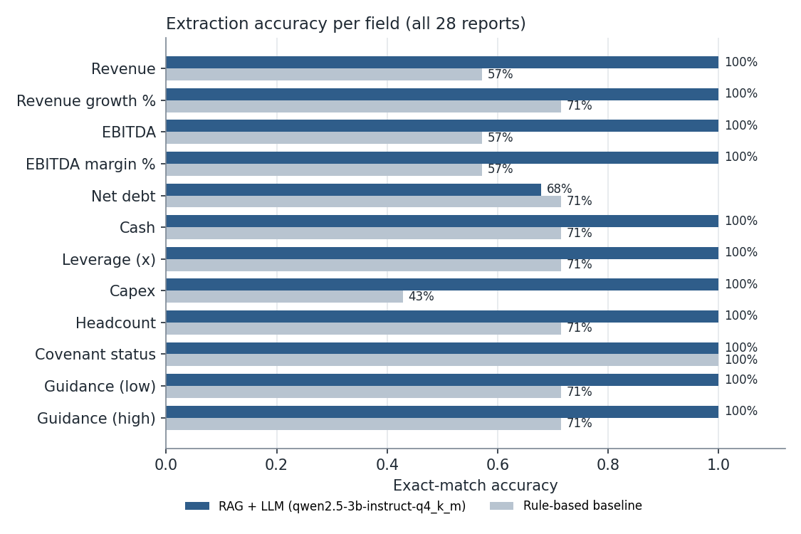
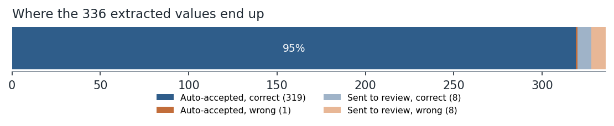
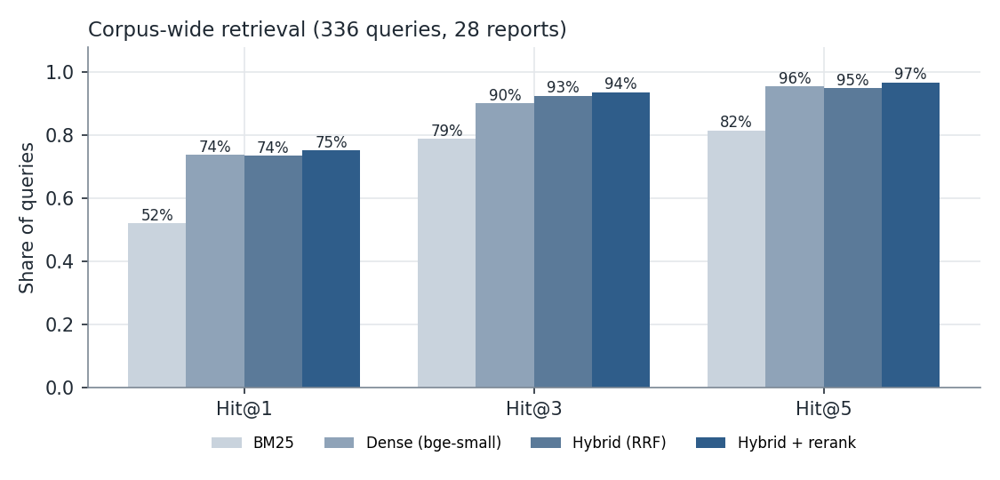
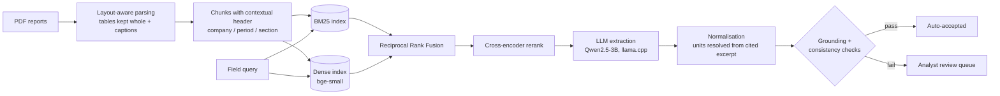

# Financial Reports RAG

Extracting KPIs from portfolio company reports for private equity analysts, with sources and a review queue.

Every quarter, each company in a private equity portfolio sends a PDF report to the fund. Analysts
then copy the same figures (revenue, EBITDA, net debt, leverage, covenant status, guidance) into
the fund's monitoring model. Every company uses its own layout and its own vocabulary, and figures
come in thousands for one and millions for the next.

This project automates that step with a retrieval-augmented pipeline that runs entirely on a
laptop CPU, with free and open models. For every report it:

- extracts 12 KPIs and normalises them (unit, scale),
- links each value to the page and excerpt it comes from,
- runs grounding and accounting consistency checks, and sends uncertain values to a human review queue.

<p align="center"><br>
<em>Extracted values traced back to the source document (blue: auto-accepted, orange: sent to review).</em></p>

## Results

Measured on 28 reports × 12 fields = 336 values with known ground truth, using a quantised
Qwen2.5-3B on a 4-core laptop CPU (8 GB RAM).

| | Rule-based baseline | RAG + LLM |
|---|---:|---:|
| Accuracy, all reports | 67.9% | **97.3%** |
| Accuracy, template A (format the rules were written for) | 91.7% | **97.5%** |
| Accuracy, template B (unseen format) | 8.3% | **96.9%** |
| Values accepted without review | - | 95.2% |
| Accuracy of the values accepted without review | - | **99.7%** |
| Errors caught by the review checks | - | 8 of 9 |
| Time per report (12 fields, CPU only) | < 0.1 s | ~170 s |

<p align="center"></p>

The rule-based approach does well on the layout it was written for, then collapses as soon as a
company words its KPIs differently or orders its columns another way. In a fund, that means rewriting
rules every time a company joins the portfolio. The RAG pipeline keeps the same accuracy on the unseen format.

<p align="center"></p>

**Error analysis.** All 9 remaining errors are on net debt:
- 6 times, the model returned the leverage multiple (`1.7x`) instead of the amount, because the
  table row is labelled *Leverage (net debt / LTM EBITDA)*;
- 3 times, in template B, it picked the prior-period column, which that template prints first.

Since grounding cannot catch either case (the wrong number is in the document), two deterministic
checks were added after the first evaluation run: a type check (an amount cannot end in `x` or `%`)
and a cross-check (net debt / leverage must give an LTM EBITDA close to 4 × the quarterly EBITDA).
Errors accepted without review dropped from 6 to 1, without re-running the model. The checks are
re-applied to the stored model outputs by `scripts/evaluate.py`.

<p align="center"></p>

**Retrieval.** Every field of every report is queried against the whole corpus (336 queries over
280 chunks). A hit means a retrieved chunk is from the right report *and* contains the exact
printed value. This is hard, because the 28 reports are nearly identical apart from their numbers.

| Retriever | Hit@1 | Hit@3 | Hit@5 | MRR@10 |
|---|---:|---:|---:|---:|
| BM25 | 52.1% | 78.9% | 81.5% | 0.666 |
| Dense (bge-small-en-v1.5) | 73.8% | 90.2% | 95.5% | 0.824 |
| Hybrid (RRF) | 73.5% | 92.6% | 94.9% | 0.830 |
| Hybrid + cross-encoder rerank | **75.3%** | **93.8%** | **96.7%** | **0.846** |

<p align="center"></p>

## How it works



| Step | What it does | Why |
|---|---|---|
| Parsing | PyMuPDF table detection; every table becomes one chunk with its caption | Fixed-size chunking cuts tables and separates numbers from their column headers and unit |
| Contextual headers | Each chunk is prefixed with `company \| period \| section` | 28 near-identical reports: a chunk is useless if you cannot tell whose numbers they are |
| Hybrid retrieval | BM25 + dense embeddings, fused with RRF, then cross-encoder reranking | BM25 matches names and periods exactly, embeddings match synonyms (turnover / revenue) |
| Grouped extraction | 4 LLM calls per report (P&L, balance sheet, operations, outlook) | Short focused prompts for a small model, without paying for 12 calls |
| Copy, don't compute | The LLM copies numbers as written; unit scaling is done in code | Keeps arithmetic out of a 3B model |
| Grounding | The extracted number must appear in the excerpt the model used | Catches invented or recomputed values |
| Consistency | margin = EBITDA / revenue, guidance low <= high, guidance vs. quarterly revenue... | Catches unit errors and prior-year/actual column mix-ups |

More detail on the choices and their trade-offs is in [docs/DESIGN_NOTES.md](docs/DESIGN_NOTES.md).

## Evaluation data

Real portfolio reports are confidential, so the evaluation corpus is generated by
[`scripts/generate_reports.py`](scripts/generate_reports.py): 7 fictional companies × 4 quarters = 28
reports (automotive suppliers, EV charging, logistics, diagnostics, payments, software). The generator
reproduces the difficulties found in real reports and stores the exact ground truth:

- several names for the same metric (Revenue / Net sales / Turnover / Recurring revenue),
- figures in EUR m for some companies and USD '000 for others, in three currencies,
- prior-year and budget columns next to the actual figures,
- KPIs that only appear in prose (headcount, sometimes capex),
- a covenant breach followed by a waiver.

Two templates are used. The rule-based baseline was written from template A (5 companies).
Template B (2 companies) uses different wording and puts the prior-year column first, which
simulates a new company joining the portfolio with its own format.

## Quickstart

```bash
git clone https://github.com/Abidar-Mohammed/financial-reports-rag.git
cd financial-reports-rag
python -m venv .venv && source .venv/bin/activate      # Windows: .venv\Scripts\activate
pip install -r requirements.txt --extra-index-url https://abetlen.github.io/llama-cpp-python/whl/cpu
pip install -e .
python scripts/download_models.py                       # Qwen2.5-3B GGUF, about 2 GB
```

```bash
python scripts/generate_reports.py --out data           # optional: the PDFs are already in data/reports
finrag index data/reports                               # parse + embed (about 1 min on CPU)
finrag extract data/reports/fenwick_payments_q1_2025.pdf
```

```text
Fenwick Payments - Q1 2025   (llamacpp/qwen2.5-3b-instruct-q4_k_m, 180.1s)
field                        value  page  status
revenue                     26.200     1  ok
revenue_growth_pct          17.000     1  ok
ebitda                       6.900     1  ok
ebitda_margin_pct           26.300     1  ok
net_debt                     1.700     1  REVIEW '1.7x' looks like a ratio or percentage, not an amount; net debt /
                                             leverage implies LTM EBITDA of 1.0, vs ~27.6 from the quarter
cash                         9.000     1  ok
leverage_ratio               1.700     1  REVIEW net debt / leverage implies LTM EBITDA of 1.0, vs ~27.6 from the quarter
capex                        2.300     1  ok
headcount                      440     2  ok
covenant_status          compliant     1  ok
guidance_low               102.000     2  ok
guidance_high              106.000     2  ok
```

Amounts are in millions of the reporting currency. In this example, the model confused net debt with
the leverage multiple, and the checks sent both fields to review instead of letting a wrong number
reach the monitoring model.

Ask free-form questions across all reports, with citations:

```bash
finrag ask "Which company breached a covenant in 2025 and what happened next?"
```

```text
[Helios E-Mobility] [E1] Helios E-Mobility breached its leverage covenant at the test date in Q3 2025.
Management has opened discussions with the lenders.

Sources:
  [E1] helios_e_mobility_q3_2025.pdf, page 2, 5. Financing and covenants
```

With a 3B model, answers that require combining several reports are incomplete. Here, the waiver
granted in Q4 is not mentioned. Question answering is a secondary feature of this project and is
not part of the evaluation above; a larger model through Groq or Ollama is the natural next step for it.

To use a larger hosted model, copy `.env.example` to `.env`, set `FINRAG_LLM_PROVIDER=groq` and add a
free [Groq](https://console.groq.com) API key. `ollama` is supported as well.

### Reproduce the evaluation

```bash
finrag extract --all --out results/extractions_qwen2.5-3b.json   # about 1h30 on a 4-core CPU
python scripts/evaluate.py retrieval
python scripts/evaluate.py extraction results/extractions_qwen2.5-3b.json
python scripts/make_figures.py
pytest
```

## Project structure

```text
src/finrag/
    ingest.py       PDF parsing and layout-aware chunking
    retrieval.py    BM25, dense, RRF fusion, cross-encoder reranking
    schema.py       the 12 fields, their descriptions and retrieval queries
    extraction.py   grouped LLM extraction, source resolution
    normalize.py    number parsing, unit scaling, scoring
    validation.py   grounding and accounting consistency checks
    baseline.py     rule-based baseline used for comparison
    qa.py           free-form questions with citations
    llm.py          llama.cpp / Groq / Ollama / transformers back-ends
    cli.py          finrag index | extract | ask
scripts/            data generation, evaluation, figures
data/               28 generated reports + ground_truth.json
results/            extraction outputs and metrics
docs/               design notes and figures
tests/              unit tests
```

## Limitations and next steps

- The reports are synthetic, so they are cleaner than real ones: no scanned pages, no tables spanning two pages, no footnotes.
- Latency is measured on a CPU-only laptop; a GPU or a hosted model is one to two orders of magnitude faster.
- Next: OCR for scanned reports, a per-company memory of label mappings confirmed by analysts, quarter-over-quarter anomaly checks, and export to the fund's monitoring model with an audit trail.

## License

MIT
